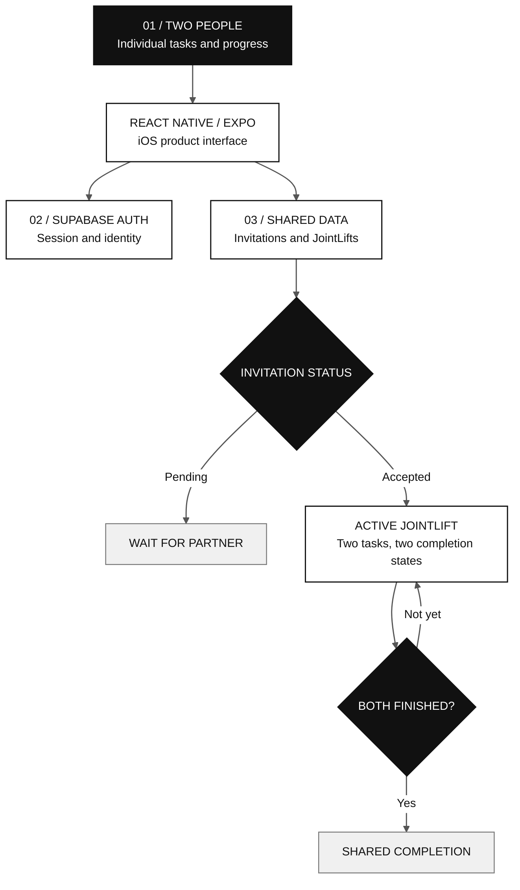

# JointLift


**Two people. Two responsibilities. One shared commitment.**

JointLift is a mobile accountability app designed to make it easier for two people to make progress together without turning a simple commitment into a project management system. I designed and built a React Native and Expo iOS MVP backed by Supabase authentication and shared data.

This repository is a **public technical companion, not the original application source**. It documents the product architecture and includes standalone, testable examples adapted from its core implementation decisions. All records and names used here are invented. The private `jointlift` repository, production environment and user data are not included.

[View the case study](https://barbarakprokop.com/productdesign/jointlift/) · [Product design portfolio](https://barbarakprokop.com/productdesign/) · [GitHub profile](https://github.com/barbarakprokop)

## The interaction model

Each person owns one task. Both can see the other's progress, but completing your own task does not complete your partner's. An invitation must be accepted before the shared space becomes active. Completion is a deliberate shared state, not a generic group to-do list.

## Architecture



The diagram describes the conceptual flow observed in the mobile code, **not a security certification**. Supabase schema, deployed row level security policies and database migrations are not available in the inspected GitHub repository.

## Selected implementation decisions

| Decision | Why it matters |
| --- | --- |
| Strictly two participants | Makes ownership and progress understandable without building a general task platform. |
| Invitation lifecycle | A pending invitation cannot become an active shared commitment without acceptance. |
| Symmetric participant view | Every person sees *my task* and *partner task*, regardless of who sent the invitation. |
| Independent completion | One participant finishing does not silently mark the other finished. |
| Scoped invitation cancellation | The app filters deletion by invitation ID, owner and pending status, and waits for backend confirmation before updating local UI. |
| Authenticated sessions | User identity is obtained from Supabase auth rather than trusting an arbitrary display name. |

## Working, standalone examples

These modules illustrate decisions in the private React Native code but **do not connect to Supabase**:

- [`src/lift-state.mjs`](src/lift-state.mjs): synthetic invite acceptance and task completion.
- [`src/participant-view.mjs`](src/participant-view.mjs): mapping database-style fields into a participant-centric UI.
- [`src/invitation-cancellation.mjs`](src/invitation-cancellation.mjs): cancellation scope and waiting for confirmed deletion.
- [`examples/jointlift.json`](examples/jointlift.json): invented scenario.
- [`tests/logic.test.mjs`](tests/logic.test.mjs): seven Node.js tests for the examples.

With Node.js 20 or newer:

```bash
npm test
```

## Technology and boundaries

**Design:** Product strategy, UX and interaction design, Figma.  
**Implementation:** React Native, Expo, TypeScript, React context and Supabase.  
**Product status:** iOS MVP tested through external TestFlight, as described in the portfolio case study.

The public examples are pure JavaScript; they are not a runnable app or a substitute for database permissions. **Authoritative access control must be enforced by the backend**, and it has not been audited here. See [technical decisions](docs/technical-decisions.md) and [security notes](SECURITY.md).

**PRODUCT DESIGNER & BUILDER · AI PRODUCTS & WORKFLOWS**
